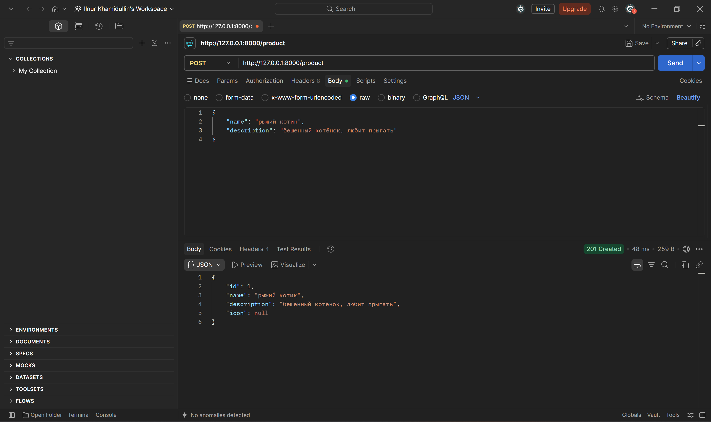
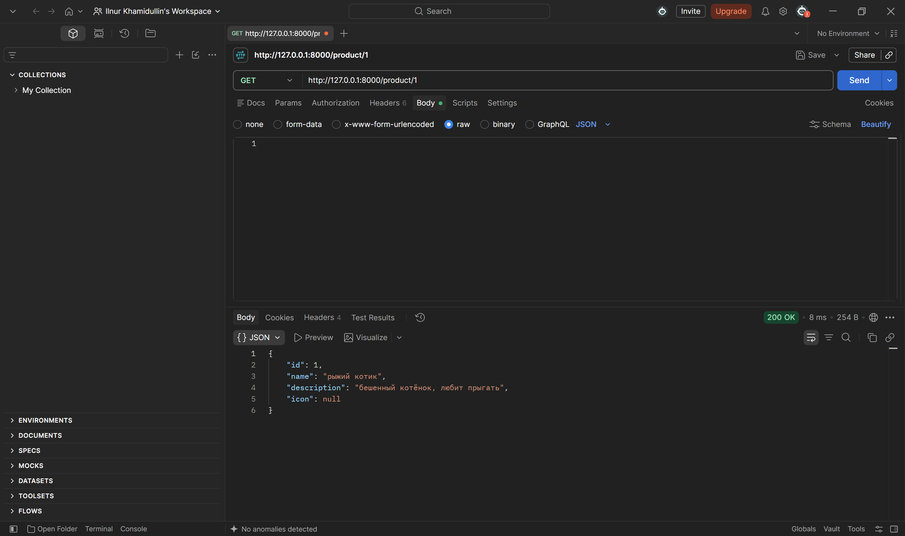
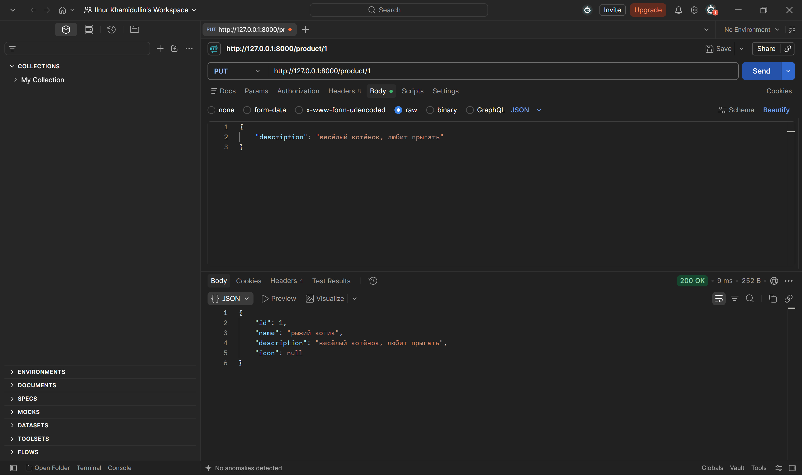
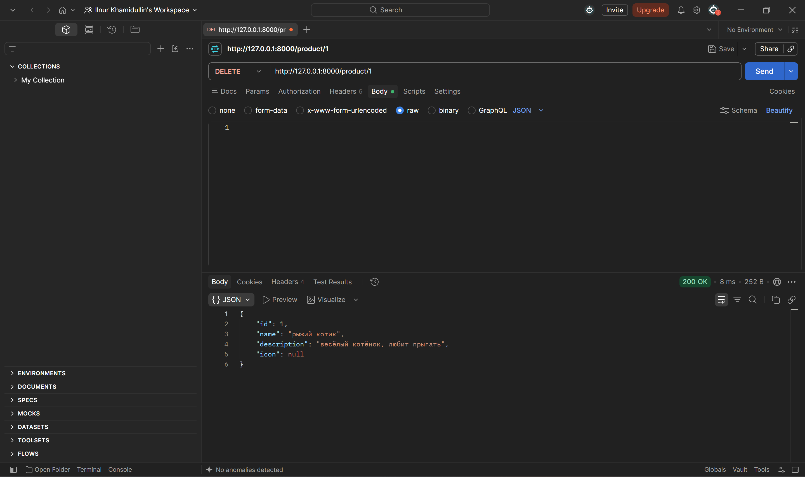
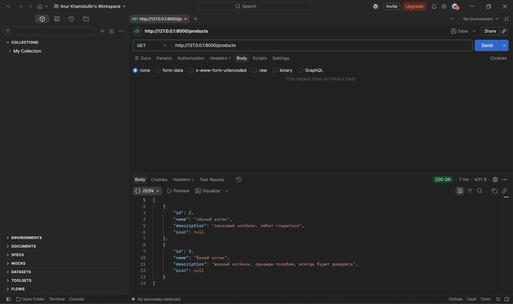
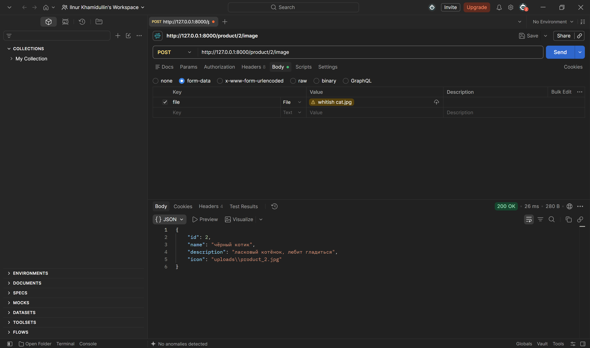
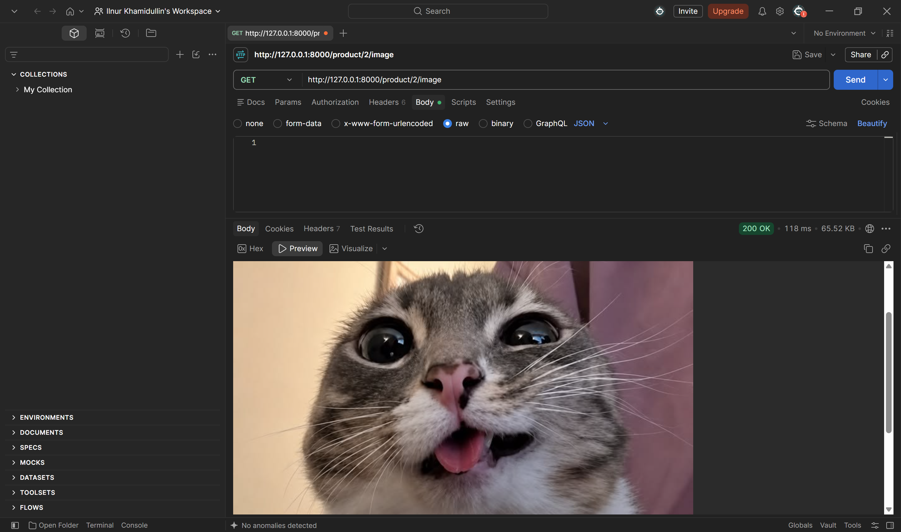

# Практика 2. Rest Service

## Программирование. Rest Service. Часть I

### Задание А (3 балла)
Создайте простой REST сервис, в котором используются HTTP операции GET, POST, PUT и DELETE.
Предположим, что это сервис для будущего интернет-магазина, который пока что умеет 
работать только со списком продуктов. У каждого продукта есть поля: `id` (уникальный идентификатор),
`name` и `description`. 

Таким образом, json-схема продукта (обозначим её `<product-json>`):

```json
{
  "id": 0,
  "name": "string",
  "description": "string"
}
```

Данные продукта от клиента к серверу должны слаться в теле запроса в виде json-а, **не** в параметрах запроса.

Ваш сервис должен поддерживать следующие операции:
1. Добавить новый продукт. При этом его `id` должен сгенерироваться автоматически
   - `POST /product`
   - Схема запроса:
     ```json
     {
       "name": "string",
       "description": "string"
     }
     ```
   - Схема ответа: `<product-json>` (созданный продукт)
2. Получить продукт по его id
   - `GET /product/{product_id}`
   - Схема ответа: `<product-json>`
3. Обновить существующий продукт (обновляются только те поля продукта, которые были переданы в теле запроса)
   - `PUT /product/{product_id}`
   - Схема запроса: `<product-json>` (некоторые поля могут быть опущены)
   - Схема ответа: `<product-json>` (обновлённый продукт)
4. Удалить продукт по его id
   - `DELETE /product/{product_id}`
   - Схема ответа: `<product-json>` (удалённый продукт)
5. Получить список всех продуктов 
   - `GET /products`  
   - Схема ответа:
     ```
     [ 
       <product-json-1>,
       <product-json-2>, 
       ... 
     ]
     ```

Предусмотрите возвращение ошибок (например, если запрашиваемого продукта не существует).

Вы можете положить код сервиса в отдельную директорию рядом с этим документом.

### Задание Б (3 балла)
Продемонстрируйте работоспособность сервиса с помощью программы Postman
(https://www.postman.com/downloads) и приложите соответствующие скрины, на которых указаны
запросы и ответы со стороны сервиса для **всех** его операций.

#### Демонстрация работы
1. 
2. 
3. 
4. 
4(error handling). 
5. 

### Задание В (4 балла)
Пусть ваш продукт также имеет иконку (небольшую картинку). Формат иконки (картинки) может
быть любым на ваш выбор. Для простоты будем считать, что у каждого продукта картинка одна.

Добавьте две новые операции:
1. Загрузить иконку:
   - `POST product/{product_id}/image`
   - Запрос содержит бинарный файл — изображение  
     
2. Получить иконку:
   - `GET product/{product_id}/image`
   - В ответе передаётся только сама иконка  
     

Измените операции в Задании А так, чтобы теперь схема продукта содержала сведения о загруженной иконке, например, имя файла или путь:
```json
"icon": "string"
```

#### Демонстрация работы
1. 
2. 

---

_(*) В последующих домашних заданиях вам будет предложено расширить функционал данного сервиса._

## Задачи

### Задача 1 (2 балла)
Общая (сквозная) задержка прохождения для одного пакета от источника к приемнику по пути,
состоящему из $N$ соединений, имеющих каждый скорость $R$ (то есть между источником и
приемником $N - 1$ маршрутизатор), равна $d_{\text{сквозная}} = N \dfrac{L}{R}$
Обобщите данную формулу для случая пересылки количества пакетов, равного $P$.

#### Решение
- Общее время складывается из времени для полного пути первого пакета плюс $P - 1$ задержка между следующими пакетами.
- Итого $d_{\text{всего}}$ = $N \dfrac{L}{R} + \dfrac{L}{R} * (P - 1)$ = $\dfrac{L(N + P - 1)}{R}$

### Задача 2 (2 балла)
Допустим, мы хотим коммутацией пакетов отправить файл с хоста A на хост Б. Между хостами установлены три
последовательных канала соединения со следующими скоростями передачи данных:
$R_1 = 200$ Кбит/с, $R_2 = 3$ Мбит/с и $R_3 = 2$ Мбит/с.
Сколько времени приблизительно займет передача на хост Б файла размером $5$ мегабайт?
Как это время зависит от размера пакета?

#### Решение
- Пренебрегая задержками пути, остаются только задержки очереди и конвертации на маршрутизаторах битов в физику. В модели с равными пакетами, задержки очереди между соседними пакетами формируются на самом медленном узле, и далее уже не меняются.
- Итого снова складывается из времени полного пути первого пакета плюс $P - 1$ задержка между следующими пакетами, которая считается на самом медленном узле и равна $\dfrac{L}{R_\text{min}}$ для каждого из $P - 1$ промежутков.
- Ответ складывается в $\left(\dfrac{L}{R_1} + \dfrac{L}{R_2} + \dfrac{L}{R_3}\right) + \dfrac{(P - 1)L}{R_\text{min}}$ = $L\left(\dfrac{1}{R_1} + \dfrac{1}{R_2} + \dfrac{1}{R_3} - \dfrac{1}{R_\text{min}}\right) + \dfrac{PL}{R_\text{min}}$, где $PL = F$ размеру файла
- Для наших чисел это получается $\dfrac{5*8}{0.2} = 200$ секунд, плюс линейная добавка, пропорционально зависящая от размера пакета $L$.

### Задача 3 (2 балла)
Предположим, что пользователи делят канал с пропускной способностью $2$ Мбит/с. Каждому
пользователю для передачи данных необходима скорость $100$ Кбит/с, но передает он данные
только в течение $20$ процентов времени использования канала. Предположим, что в сети всего $60$
пользователей. А также предполагается, что используется сеть с коммутацией пакетов. Найдите
вероятность одновременной передачи данных $12$ или более пользователями.

#### Решение
Здесь не понадобятся никакие пропускные скорости, вопрос по сути по теорверу.
Если каждый пользователь из $60$-ти в моменте активен с вероятностью $p = 0.2$, то распределение количества активных пользователей описывается $Bin(60, 0.2)$. 

Мы хотим найти $P(X \ge 12) = 1 - P(X < 12)$. Это просто один минус сумма 12 слагаемых, которые находятся цешками на произведение соответствующих степеней вероятностей $p$ и $1 - p$. Если посчитать, получается $55.13\%$(compute.py)

### Задача 4 (2 балла)
Пусть файл размером $X$ бит отправляется с хоста А на хост Б, между которыми три линии связи и
два коммутатора. Хост А разбивает файл на сегменты по $S$ бит каждый и добавляет к ним
заголовки размером $80$ бит, формируя тем самым пакеты длиной $L = 80 + S$ бит. Скорость
передачи данных по каждой линии составляет $R$ бит/с. Загрузка линий мала, и очередей пакетов
нет. При каком значении $S$ задержка передачи файла между хостами А и Б будет минимальной?
Задержкой распространения сигнала пренебречь.

#### Решение
Из 2-ой задачи имеем для конкретного $s$:

$L = 80 + s$,

$P = \dfrac{X}{L}$

$(80 + s)*\dfrac{3 + \dfrac{X}{s} - 1}{R}$, которое мы хотим минимизировать.

$\dfrac{1}{R}$ - константа, остается:

$80 * 2 + X + \dfrac{80X}{s} + 2s$, снова можно забить на $80 * 2 + X$ - константу.

Осталось найти минимум $\dfrac{80X}{s} + 2s$, функция на $(0, +\inf)$ выпукла как сумма двух таких слагаемых. Тогда, так как "значения" в нуле и inf равны +inf, надо найти экстремум и он будет min.

Производная равна $-\dfrac{80X}{s^2} + 2$ и зануляется в $s = \sqrt{40X}$, там и будет минимум (да, не целый, но дискретный минимум где-то в соседней точке)

### Задание 5 (2 балла)
Рассмотрим задержку ожидания в буфере маршрутизатора. Обозначим через $I$ интенсивность
трафика, то есть $I = \dfrac{L a}{R}$.
Предположим, что для $I < 1$ задержка ожидания вычисляется как $\dfrac{I \cdot L}{R (1 – I)}$. 
1. Напишите формулу для общей задержки, то есть суммы задержек ожидания и передачи.
2. Опишите зависимость величины общей задержки от значения $\dfrac{L}{R}$.

#### Решение
Рассмотрим что происходит для $I < 1$

$d_\text{ож} = \dfrac{I \cdot L}{R (1 – I)}$

$d_\text{пер} = \dfrac{L}{R}$

$d_\text{total} = d_\text{ож} + d_\text{пер} = \dfrac{L}{R}\left(1 + \dfrac{I}{1 - I}\right) = \dfrac{L}{R} \cdot \dfrac{1}{1 - I}$

$d_\text{total} = \dfrac{L/R}{1 - a(L/R)}$

- На маленьких $I$ значение примерно равно $L/R$, только чуть больше
- На $I$ приближающемся к 1, значение становится обратно пропорциональным $1 - I$ с каким-то коэффициентом, то есть крайне быстро улетает в бесконечность (что согласуется с интуицией)
