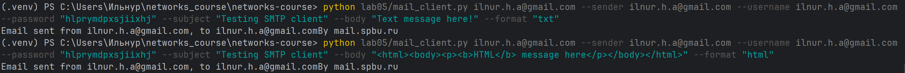
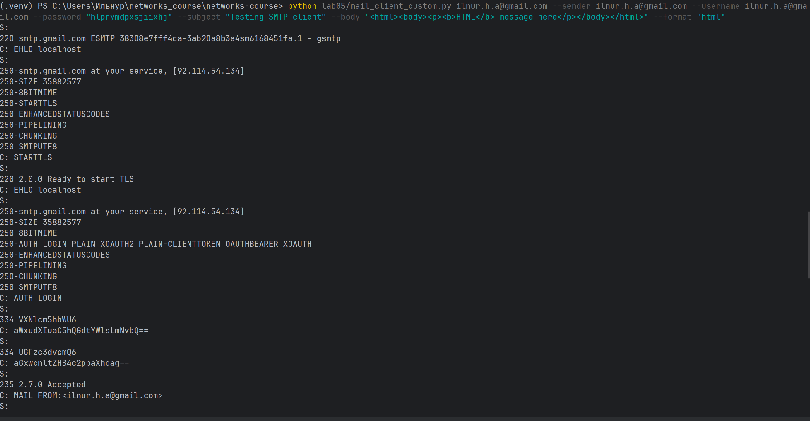
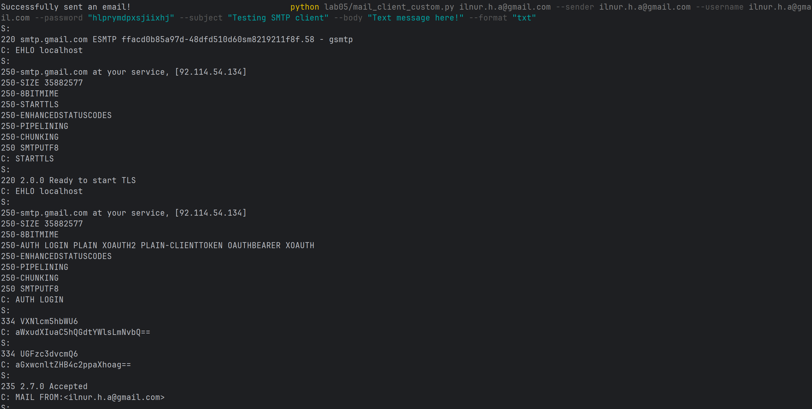
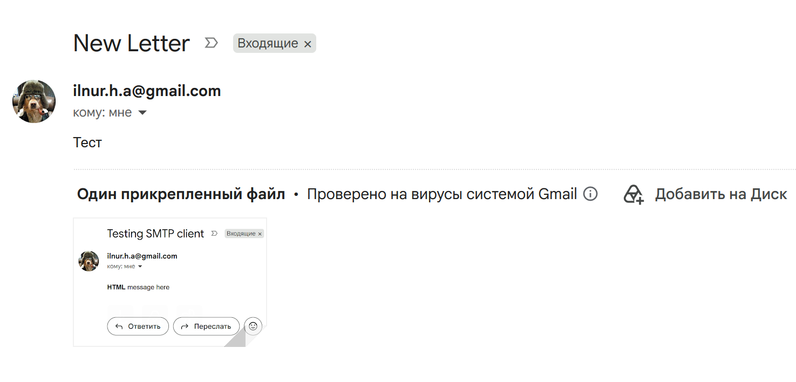
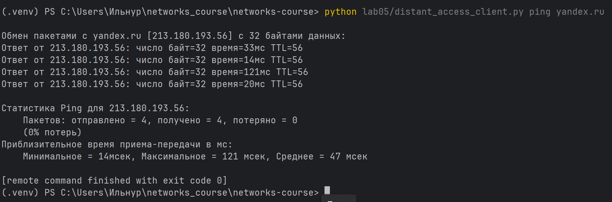
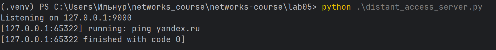
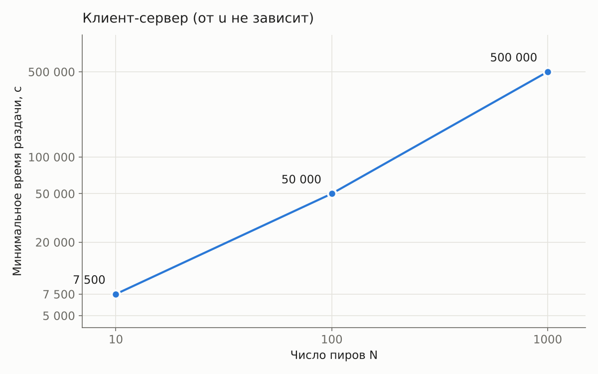
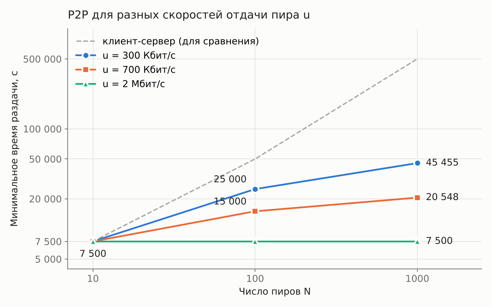

# Практика 5. Прикладной уровень

## Программирование сокетов.

### A. Почта и SMTP (7 баллов)

### 1. Почтовый клиент (2 балла)
Напишите программу для отправки электронной почты получателю, адрес
которого задается параметром. Адрес отправителя может быть постоянным. Программа
должна поддерживать два формата сообщений: **txt** и **html**. Используйте готовые
библиотеки для работы с почтой, т.е. в этом задании **не** предполагается общение с smtp
сервером через сокеты напрямую.

Приложите скриншоты полученных сообщений (для обоих форматов).

#### Демонстрация работы

### 2. SMTP-клиент (3 балла)
Разработайте простой почтовый клиент, который отправляет текстовые сообщения
электронной почты произвольному получателю. Программа должна соединиться с
почтовым сервером, используя протокол SMTP, и передать ему сообщение.
Не используйте встроенные методы для отправки почты, которые есть в большинстве
современных платформ. Вместо этого реализуйте свое решение на сокетах с передачей
сообщений почтовому серверу.

Сделайте скриншоты полученных сообщений.

#### Демонстрация работы

### 3. SMTP-клиент: бинарные данные (2 балла)
Модифицируйте ваш SMTP-клиент из предыдущего задания так, чтобы теперь он мог
отправлять письма с изображениями (бинарными данными).

Сделайте скриншот, подтверждающий получение почтового сообщения с картинкой.

#### Демонстрация работы

---

_Многие почтовые серверы используют ssl, что может вызвать трудности при работе с ними из
ваших приложений. Можете использовать для тестов smtp сервер СПбГУ: mail.spbu.ru, 25_

### Б. Удаленный запуск команд (3 балла)
Напишите программу для запуска команд (или приложений) на удаленном хосте с помощью TCP сокетов.

Например, вы можете с клиента дать команду серверу запустить приложение Калькулятор или
Paint (на стороне сервера). Или запустить консольное приложение/утилиту с указанными
параметрами. Однако запущенное приложение **должно** выводить какую-либо информацию на
консоль или передавать свой статус после запуска, который должен быть отправлен обратно
клиенту. Продемонстрируйте работу вашей программы, приложив скриншот.

Например, удаленно запускается команда `ping yandex.ru`. Результат этой команды (запущенной на
сервере) отправляется обратно клиенту.

#### Демонстрация работы

### В. Широковещательная рассылка через UDP (2 балла)
Реализуйте сервер (веб-службу) и клиента с использованием интерфейса Socket API, которая:
- работает по протоколу UDP
- каждую секунду рассылает широковещательно всем клиентам свое текущее время
- клиент службы выводит на консоль сообщаемое ему время

#### Демонстрация работы
todo

## Задачи

### Задача 1 (2 балла)
Рассмотрим короткую, $10$-метровую линию связи, по которой отправитель может передавать
данные со скоростью $150$ бит/с в обоих направлениях. Предположим, что пакеты, содержащие
данные, имеют размер $100000$ бит, а пакеты, содержащие только управляющую информацию
(например, флаг подтверждения или информацию рукопожатия) – $200$ бит. Предположим, что у
нас $10$ параллельных соединений, и каждому предоставлено $1/10$ полосы пропускания канала
связи. Также допустим, что используется протокол HTTP, и предположим, что каждый
загруженный объект имеет размер $100$ Кбит, и что исходный объект содержит $10$ ссылок на другие
объекты того же отправителя. Будем считать, что скорость распространения сигнала равна
скорости света ($300 \cdot 10^6$ м/с).
1. Вычислите общее время, необходимое для получения всех объектов при параллельных
непостоянных HTTP-соединениях
2. Вычислите общее время для постоянных HTTP-соединений. Ожидается ли существенное
преимущество по сравнению со случаем непостоянного соединения?

#### Решение

**1. Параллельные непостоянные соединения**

Получение каждого объекта по новому TCP-соединению — это 3 управляющих пакета(это вместе с HTTP-запросом) и 1 пакет с объектом. На каждый объект хватает одного пакета данных по условию.

Каждый из пакетов ждёт предыдущего, поэтому вносит дополнительный вклад задержки распространения. Итого выходит 4 от базового объекта и 4 от параллельных 10 (а не 10 * 4, так как параллельные друг друга не ждут)

$$t_{\text{prop}} = 8 \cdot \frac{10 \text{ м}}{3 \cdot 10^8 \text{ м/с}} \approx 8 \cdot 3{,}33 \cdot 10^{-8} \text{ с} \approx 2{,}67 \cdot 10^{-7} \text{ с}$$

Для базового объекта, видимо, считаем что он может пользоваться всей шириной канала

$$t_{\text{base}} = \frac{3 \cdot 200 + 100000 \text{ бит}}{150 \text{ бит/с}} = \frac{100600}{150} \text{ с} \approx 670{,}67 \text{ с}$$

Для параллельных каждому по 15 бит/с:

$$t_{\text{par}} = \frac{3 \cdot 200 + 100000 \text{ бит}}{15 \text{ бит/с}} = \frac{100600}{15} \text{ с} \approx 6706{,}67 \text{ с}$$

Итого:

$$t_1 = t_{\text{base}} + t_{\text{par}} + t_{\text{prop}} \approx 670{,}67 + 6706{,}67 + 2{,}67 \cdot 10^{-7} \approx 7377{,}33 \text{ с}$$

Задержка распространения оказалась пренебрежима

**2. Постоянное соединение**

Базовый объект получаем так же, как в первом пункте:

$$t_{\text{base}} \approx 670{,}67 \text{ с}$$

Дальше 10 объектов идут по уже открытому соединению: рукопожатия нет, только запрос и ответ. Соединение одно, поэтому весь канал $150$ бит/с его, но объекты теперь идут последовательно:

$$t_{\text{obj}} = 10 \cdot \frac{200 + 100000 \text{ бит}}{150 \text{ бит/с}} = \frac{1002000}{150} \text{ с} = 6680 \text{ с}$$

Задержек распространения теперь больше: 4 от базового объекта и по 2 (запрос и ответ) на каждый из 10 объектов, в сумме 24:

$$t_{\text{prop}} = 24 \cdot 3{,}33 \cdot 10^{-8} \text{ с} \approx 8 \cdot 10^{-7} \text{ с}$$

Итого:

$$t_2 = t_{\text{base}} + t_{\text{obj}} + t_{\text{prop}} \approx 670{,}67 + 6680 + 8 \cdot 10^{-7} \approx 7350{,}67 \text{ с}$$

Выигрыш: $t_1 - t_2 \approx 26{,}67$ с, относительно $\approx 7000$ это мелочь. По факту постоянное соединение жертвует лишними задержками распространения, но экономит на проталкивании лишних бит этапов рукопожатия $2\cdot200$ за объект. И пока расстояния не огромны выигрыш всегда будет перевешивать, но с такими крупными объектами это все ещё мелочь. Но с большим количеством маленьких объектов поддерживать соединение будет, естественно, ощутимо полезнее. 

### Задача 2 (3 балла)
Рассмотрим раздачу файла размером $F = 15$ Гбит $N$ пирам. Сервер имеет скорость отдачи $u_s = 30$
Мбит/с, а каждый узел имеет скорость загрузки $d_i = 2$ Мбит/с и скорость отдачи $u$. Для $N = 10$, $100$
и $1000$ и для $u = 300$ Кбит/с, $700$ Кбит/с и $2$ Мбит/с подготовьте график минимального времени
раздачи для всех сочетаний $N$ и $u$ для вариантов клиент-серверной и одноранговой раздачи.

#### Решение

Клиент-сервер

Все $N$ копий файла раздаёт сервер, отсюда $t \ge \frac{NF}{u_s}$. При этом каждый пир должен скачать файл целиком, отсюда $t \ge \frac{F}{d} = 7500$ с. Итого:

$$t_{cs} = \max\left(\frac{NF}{u_s}, \frac{F}{d}\right)$$

От $u$ не зависит: при $N = 10, 100, 1000$ получаем $7500$, $50000$ и $500000$ с.

**P2P**

Сервер должен отдать хотя бы одну копию, отсюда ограничение $t \ge \frac{F}{u_s} = 500$ с.
Каждый пир должен скачать файл, отсюда ограничение $t \ge \frac{F}{d} = 7500$ с.
И всего нужно передать $NF$ бит, отдают сервер и пиры общими усилиями со скоростью не больше $u_s + Nu$, отсюда $t \ge \frac{NF}{u_s + Nu}$.

Объединяя ограничения:

$$t_{p2p} = \max\left(\frac{F}{u_s}, \frac{F}{d}, \frac{NF}{u_s + Nu}\right)$$

| | $N = 10$ | $N = 100$ | $N = 1000$ |
|---|---|---|---|
| $u = 300$ Кбит/с | 7500 | 25000 | 45455 |
| $u = 700$ Кбит/с | 7500 | 15000 | 20548 |
| $u = 2$ Мбит/с | 7500 | 7500 | 7500 |

### Задача 3 (3 балла)
Рассмотрим клиент-серверную раздачу файла размером $F$ бит $N$ пирам, при которой сервер
способен отдавать одновременно данные множеству пиров – каждому с различной скоростью,
но общая скорость отдачи при этом не превышает значения $u_s$. Схема раздачи непрерывная.
1. Предположим, что $\dfrac{u_s}{N} \le d_{min}$.
   При какой схеме общее время раздачи будет составлять $\dfrac{N F}{u_s}$?
2. Предположим, что $\dfrac{u_s}{N} \ge d_{min}$. 
   При какой схеме общее время раздачи будет составлять  $\dfrac{F}{d_{min}}$?
3. Докажите, что минимальное время раздачи описывается формулой $\max\left(\dfrac{N F}{u_s}, \dfrac{F}{d_{min}}\right)$?

#### Решение

1. Сервер раздаёт всем пирам одновременно по $\frac{u_s}{N}$ бит/с, в сумме ровно $u_s$. По условию $\frac{u_s}{N} \le d_{min}$, так что каждый пир сможет это принять. Время для каждого пира одно и то же:

$$\frac{F}{u_s / N} = \frac{NF}{u_s}$$

2. Сервер раздаёт всем пирам по $d_{min}$ бит/с. В сумме это $N d_{min} \le u_s$ по условию, так что сервер справится, а пиры, очевидно, могут это принять. Время:

$$\frac{F}{d_{min}}$$

3. Во второй задаче мы уже увидели, почему в клиент-серверной раздаче $t \ge \max\left(\frac{NF}{u_s}, \frac{F}{d_{min}}\right)$: сервер должен отдать $NF$ бит, а самый медленный пир — скачать $F$ бит. А сейчас показали, что в двух исчерпывающих случаях реализуется одно из значений, причём именно больший аргумент.

То есть в случае 1 максимум — это $\frac{NF}{u_s}$, в случае 2 — $\frac{F}{d_{min}}$. Значит, нижняя граница всегда достигается, и минимальное время раздачи равно $\max\left(\frac{NF}{u_s}, \frac{F}{d_{min}}\right)$.
